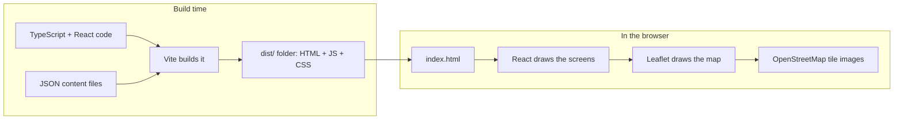

# Technology Guide: everything used in this app, explained

A reading guide for the finished app. It covers the libraries, the React and TypeScript ideas, the patterns, and the principles, with an example from this project for each. File paths are relative to the project folder.

**Suggested reading order:** section 1 (the big picture), then 3 (React) and 4 (TypeScript) with the code open beside you, then 5 to 8 as reference.

---

## 1. The big picture

The app is a **single-page application (SPA)**: the browser loads one HTML page and JavaScript draws and updates everything on it. There is no server code and no database. The content lives in JSON files that are built into the page.



| Layer | Technology | Job |
|---|---|---|
| Language | TypeScript | JavaScript plus types, checked before the app runs |
| UI | React | Builds screens from small reusable pieces |
| Map | Leaflet | Draws the interactive map |
| Build and dev | Vite | Dev server and production build |
| Tests | Vitest | Runs the automated checks |
| Content | JSON files | The facts, sources, and map points |
| Styling | Plain CSS | Layout, colours, responsive design |
| Packages | npm | Installs and tracks libraries |

---

## 2. Libraries and tools, one by one

### 2.1 Runtime libraries (ship to the user): `dependencies`

| Library | What it is | Where used |
|---|---|---|
| **react** | The core library for building user interfaces from components | Every `.tsx` file |
| **react-dom** | Connects React to the browser page | `src/main.tsx` (`createRoot`) |
| **leaflet** | A small, open-source library for interactive maps | `src/screens/MapScreen.tsx` |

Leaflet also loads its own stylesheet: `import 'leaflet/dist/leaflet.css'`.

### 2.2 Development tools (not shipped): `devDependencies`

| Tool | What it is | Why |
|---|---|---|
| **typescript** | The TypeScript compiler | `tsc --noEmit` checks types during `npm run build` |
| **vite** | Build tool and dev server | `npm run dev` and `npm run build` |
| **@vitejs/plugin-react** | Lets Vite understand JSX and supports hot reload | `vite.config.ts` |
| **vitest** | Test runner that works with Vite | `npm test` |
| **@types/react, @types/react-dom, @types/leaflet** | Type descriptions for libraries written in plain JavaScript | So TypeScript can check how you use them |

### 2.3 npm scripts: `package.json`

| Command | What it does |
|---|---|
| `npm run dev` | Starts a local server with live reload (use this to look at the app) |
| `npm run build` | Type-checks, then makes the production files in `dist/` |
| `npm run preview` | Serves the `dist/` build locally so you can test it as it will be deployed |
| `npm test` | Runs all automated tests once |

`package-lock.json` records the exact versions installed, so every machine gets the same code.

### 2.4 External services

- **OpenStreetMap tile server** (`tile.openstreetmap.org`): supplies the map background images. This is the only network request the app makes. Leaflet shows the required attribution.

---

## 3. React: the ideas used here

React builds the screen from **components**: functions that return a description of what to show.

### 3.1 Components and JSX
A component is a function whose name starts with a capital letter. **JSX** is the HTML-like syntax inside it.

```tsx
export function CropFilter({ value, onChange }: Props) {
  return (
    <div className="crop-filter">...</div>
  )
}
```
(`src/components/CropFilter.tsx`.) JSX uses `className` instead of `class`, and `{ }` to insert JavaScript values.

### 3.2 Props
**Props** are the inputs to a component, like function arguments. `<MapScreen crop={crop} />` passes `crop` into `MapScreen`. Data flows **down** from parent to child.

### 3.3 State: `useState`
**State** is a value the component remembers between renders. Changing it re-draws the screen.

```tsx
const [tab, setTab] = useState<TabId>('map')   // src/App.tsx
```
`tab` is the current value; `setTab(...)` changes it and triggers a re-render.

### 3.4 Lifting state up
Both the Map and Compare screens need the selected crop. So the state lives in their common parent, `App`, and is passed down as props. The `CropFilter` calls `onChange` to ask the parent to change it. This is why the crop choice survives tab switches.

### 3.5 Conditional rendering
```tsx
{tab === 'compare' && <CompareScreen crop={crop} />}
{crop === 'all' && <small> · {cropLabel(p.crop)}</small>}
```
In `a && b`, `b` is shown only when `a` is true.

### 3.6 Lists and `key`
```tsx
{items.map((p) => <article key={p.id}>...</article>)}
```
Turning an array into elements with `.map`. The `key` lets React match items between renders.

### 3.7 `useMemo`: remember a calculated value
```tsx
const cropEvents = useMemo(() => forCrop(mapEvents, crop), [crop])
```
It recalculates only when `crop` changes. Here it also keeps the same array object between renders, which the map effects depend on.

### 3.8 `useEffect`: do something outside React
Effects run after the screen is drawn, for work React does not manage: creating a map, timers.

```tsx
useEffect(() => {
  const map = L.map(containerRef.current!, {...})
  return () => { map.remove() }      // cleanup runs when the component goes away
}, [cropEvents])                      // dependency list: re-run when this changes
```
The **cleanup function** matters: it prevents leftover maps and timers.

### 3.9 `useRef`: hold a reference that does not trigger a re-render
```tsx
const containerRef = useRef<HTMLDivElement>(null)
<div ref={containerRef} />
```
Used to give Leaflet the real page element to draw into.

### 3.10 Derived state
`year`, `visible`, and `refs` are **calculated** from other values instead of stored separately. Fewer stored values means fewer ways for the screen to disagree with itself.

### 3.11 Reset with `key`
```tsx
<MapScreen key={crop} crop={crop} />
```
Changing `key` makes React build a fresh component, which resets all its state. A simple way to say "start over when the crop changes".

### 3.12 `StrictMode`
Wrapping the app in `<StrictMode>` (`src/main.tsx`) makes development builds run effects twice to expose missing cleanup. It does nothing in production.

### 3.13 Accessible UI in React
`role="tablist"`, `aria-selected`, `aria-label`, `aria-live`, and `role="status"` tell screen readers what things are. Plain `<button>` elements are used for clickable things so the keyboard works for free.

---

## 4. TypeScript: the ideas used here

TypeScript adds **types** to JavaScript. The compiler (`tsc`) catches mistakes such as typos and missing fields before the app runs. Types vanish in the final build.

### 4.1 Basic types and annotations
```ts
const [index, setIndex] = useState(steps.length - 1)   // inferred as number
function formatYear(year: number): string { ... }        // parameter and return types
```

### 4.2 `interface`: the shape of an object
```ts
export interface Practice {
  id: string
  crop: CropId
  supported: Support
  sourceIds: string[]
}
```
(`src/types.ts`.) Every practice record must have these fields.

### 4.3 Union and literal types: a fixed set of allowed values
```ts
export type CropId = 'paddy' | 'oil-palm' | 'soybean'
export type Support = 'yes' | 'partly' | 'no'
```
Writing `'soy'` anywhere is a compile error. This catches data and code typos.

### 4.4 Optional fields
```ts
from?: string      // may be missing
```

### 4.5 Generics: one function for many types
```ts
export function forCrop<T extends { crop: CropId }>(items: T[], crop: CropFilterValue): T[]
```
`T` stands for "whatever type of item you pass in, as long as it has a `crop`". The same function filters map events, practices, and avoid items, and returns the same type it was given.

### 4.6 `Record<Key, Value>`: a lookup table that must be complete
```ts
const CROP_COLOR: Record<CropId, string> = { paddy: '#1f6b3a', 'oil-palm': '#b45309', soybean: '#6b3fa0' }
```
The compiler errors if a crop is missing.

### 4.7 Type assertions: `as`
```ts
export const practices = practicesRaw as Practice[]
```
You tell the compiler "trust me, this JSON has this shape". The tests in `data.test.ts` are what make that promise safe.

### 4.8 `as const`
```ts
const SEVERITY_ORDER = { high: 0, medium: 1 } as const
```
Locks the object so its values are exact (`0` and `1`), not just `number`.

### 4.9 `import type`
```ts
import type { CropFilterValue } from '../data'
```
Marks imports used only for types, which are erased at build time.

### 4.10 The non-null assertion `!`
```ts
document.getElementById('root')!
```
Says "this is definitely not null". Use it sparingly, only where a fact is guaranteed (the `root` element exists in `index.html`).

### 4.11 Strict mode
`"strict": true` in `tsconfig.json` turns on the strictest checks, including no implicit `any`. `noUnusedLocals` and `noUnusedParameters` also flag leftover code.

### 4.12 Typed props
```ts
interface Props { value: CropFilterValue; onChange: (value: CropFilterValue) => void }
```
`(value) => void` is the type of a function that takes a value and returns nothing.

---

## 5. Modern JavaScript used

| Feature | Example | Where |
|---|---|---|
| Arrow functions | `(e) => e.year <= year` | everywhere |
| `map`, `filter`, `sort`, `flatMap`, `find` | `events.filter(...)` | data helpers, screens |
| Spread `...` | `[...forCrop(...)]` copies an array; `{ ...base, doi }` | `AvoidScreen`, tests |
| Destructuring | `const [tab, setTab] = useState(...)` | `App.tsx` |
| `Set` and `Map` | unique years; lookup by id | `mapYears.ts`, `data/index.ts` |
| Template strings | `` `${-year} BCE` `` | `mapYears.ts` |
| Optional chaining and `??` | `CROPS.find(...)?.label ?? id` | `types.ts` |
| `async` / `await` and `try` / `catch` | clipboard copy | `ReferencesScreen.tsx` |
| Regular expressions | `/^10\.\d{4,9}\/\S+$/` | `citation.ts` |
| `URL` class | validates web addresses | `citation.ts` |
| ES modules | `import` / `export` | every file |

---

## 6. Build, test, and styling tools

### 6.1 Vite
- **Dev server:** serves the app and refreshes the browser when you save (hot module replacement).
- **Build:** bundles all code into a few small files in `dist/`.
- **JSON imports:** `import mapEventsRaw from './mapEvents.json'` works directly.
- **Plugins:** `vite.config.ts` has a small custom plugin that adds the CSP tag during production builds only.

### 6.2 Vitest
```ts
describe('formatYear', () => {
  it('labels BCE and CE years', () => {
    expect(formatYear(-7000)).toBe('7000 BCE')
  })
})
```
`describe` groups tests, `it` is one test, `expect(...).toBe(...)` is the check. Tests run with `npm test`.

### 6.3 Leaflet vocabulary
| Term | Meaning |
|---|---|
| `L.map` | The map object tied to a page element |
| `L.tileLayer` | The background image tiles (OpenStreetMap) |
| `L.layerGroup` | A container for markers so they can be cleared together |
| `L.circleMarker` | A circle at a latitude/longitude |
| `L.polyline` | A line through points |
| `bindPopup` | The box that opens when a marker is clicked |
| `fitBounds` | Zooms the map to show a set of points |

### 6.4 CSS ideas used (`src/styles.css`)
- **CSS variables** (`--green`, `--line`) keep colours consistent.
- **Flexbox** for rows of buttons and the slider row.
- **CSS Grid + media query** for the two-column Compare layout that stacks on phones.
- **Mobile-first:** base styles work on a phone, and wider screens add to them.
- **`:focus-visible`** gives keyboard users a clear outline.

---

## 7. Design patterns and principles

### 7.1 Patterns
| Pattern | What it means | Where you can see it |
|---|---|---|
| **Data-driven UI** | Content lives in data files. The screens only display it. Adding a fact needs no code change. | `src/data/*.json` and the screens |
| **Single source of truth** | Each fact is stored once and referenced by id. | A source is defined once in `references.json` and cited by id |
| **Lifting state up** | Shared state lives in the nearest common parent | Crop filter in `App.tsx` |
| **Derived state** | Calculate values instead of storing copies | `visible`, `refs`, `steps` |
| **Pure functions** | Same input gives the same output, no side effects, easy to test | `mapYears.ts`, `citation.ts` |
| **Separation of concerns** | Data, logic, and display are in different files | `data/`, `lib/`, `screens/`, `components/` |
| **Composition** | Small pieces combined into bigger ones | `SourceList` is used inside three screens |
| **Escape hatch for non-React libraries** | Hand a page element to the library, and clean up after it | Leaflet in `MapScreen` |
| **Effect cleanup** | Every effect that starts something stops it | `map.remove()`, `clearTimeout` |
| **Reset by key** | Change a `key` to reset a component's state | `MapScreen key={crop}` |
| **Facade / loader module** | One file is the only way to reach the data | `src/data/index.ts` |

### 7.2 Principles
| Principle | Meaning in this project |
|---|---|
| **KISS** (keep it simple) | No router, no state library, no database, no map wrapper. Plain React state and Leaflet. |
| **YAGNI** (you aren't gonna need it) | Search, accounts, and languages were left for later |
| **DRY** (don't repeat yourself) | One generic `forCrop`, one `SourceList`, one `formatCitation` |
| **Make impossible states impossible** | Union types and `Record` stop invalid values at compile time |
| **Test the data, not just the code** | `data.test.ts` checks ids, sources, crops, and links in the content |
| **Progressive disclosure** | Map first, then cards, then sources |
| **Honest uncertainty** | Confidence levels, "draft" banner, and unverified `*` markers |

---

## 8. Security and accessibility measures

### 8.1 Security
| Measure | Where | Why |
|---|---|---|
| **Content-Security-Policy** | `vite.config.ts` | The browser only runs this site's own scripts and loads only its own styles and the map tiles. Blocks injected scripts. |
| **Link validation** | `citation.ts` | Only real DOIs and `https` links become clickable, so a bad value like `javascript:...` cannot become a link |
| **No raw HTML** | Popups use `textContent`. React escapes text. No `dangerouslySetInnerHTML`. | Data can never turn into markup or scripts |
| **`rel="noopener noreferrer"`** | External links | A new tab cannot control the app |
| **No secrets** | Whole project | There are no keys, tokens, or logins |
| **No accounts or user data** | Whole project | Nothing personal is collected or stored |
| **Locked dependencies and an audit** | `package-lock.json`, `npm audit` | Known-vulnerable packages are detected (0 found at build time) |

### 8.2 Accessibility
- Real `<button>` elements, so the keyboard works.
- Tab roles and `aria-selected` on the tab bar.
- Slider has a label and spoken value ("1848 CE").
- Map information is repeated as a text list.
- Status is never shown by colour alone: badges have symbols and words.
- Visible focus outline.

---

## 9. Where to find each idea in the code

| Want to understand... | Open this file |
|---|---|
| How the app starts | `src/main.tsx` |
| Tabs, shared state, lifting state up | `src/App.tsx` |
| All data shapes and unions | `src/types.ts` |
| Generics and the data facade | `src/data/index.ts` |
| Pure helpers and regex checks | `src/lib/citation.ts`, `src/lib/mapYears.ts` |
| Effects, refs, memo, and a non-React library | `src/screens/MapScreen.tsx` |
| Records, conditional rendering, lists | `src/screens/CompareScreen.tsx` |
| Sorting a copy, derived data | `src/screens/AvoidScreen.tsx` |
| Async + error handling | `src/screens/ReferencesScreen.tsx` |
| Reusable components | `src/components/` |
| Tests | `src/data/data.test.ts`, `src/lib/*.test.ts` |
| Build and CSP | `vite.config.ts`, `index.html` |

## 10. Glossary

| Term | Plain meaning |
|---|---|
| **Component** | A reusable piece of screen written as a function |
| **Props** | Inputs passed to a component |
| **State** | A value a component remembers; changing it redraws the screen |
| **Hook** | A function starting with `use` that gives a component abilities (`useState`, `useEffect`) |
| **Render** | React working out what the screen should look like |
| **JSX / TSX** | HTML-like syntax inside JavaScript / TypeScript |
| **Bundle** | The combined files the browser downloads |
| **SPA** | Single-page application |
| **CSP** | Content-Security-Policy: a browser rule listing what the page may load and run |
| **DOI** | A permanent identifier for a published paper |
| **Tile** | A small square map image; many together form the map |
| **Type assertion** | Telling the compiler to trust a type (`as`) |
| **Generic** | A type placeholder (`T`) that lets one function work for many types |
