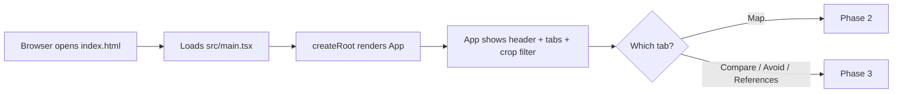
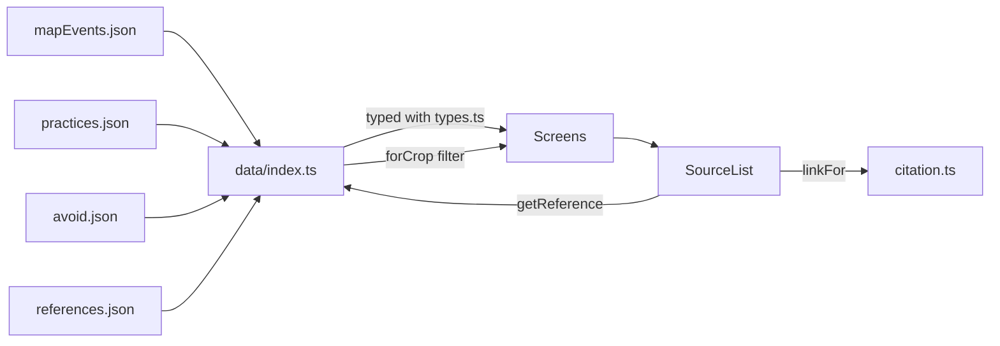
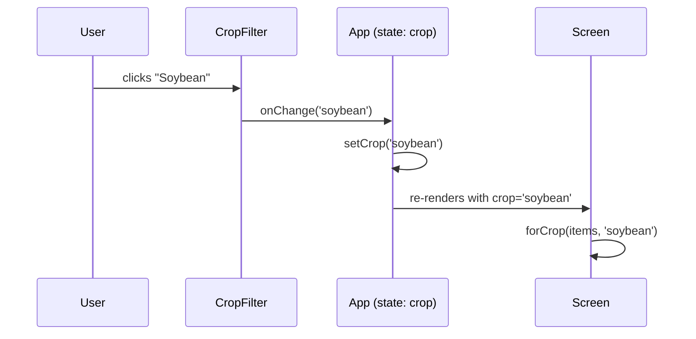
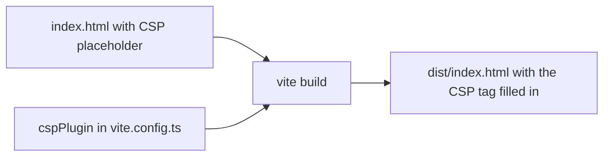

# Phase 1: Foundation and Content

**Goal:** a working project skeleton, the content data, and an app shell with four tabs. The Map, Compare, Avoid, and References screens are placeholders here and get filled in during Phases 2 and 3.

**Status:** done. `npm test` passes (11 tests) and `npm run build` succeeds.

---

## 1. What was built

| Part | What it does |
|---|---|
| Project setup | React + TypeScript + Vite, with Vitest for tests |
| Types | One file that names every kind of data in the app |
| Content | 4 JSON files: map events, practices, avoid items, references |
| Data loader | One file that loads the JSON and offers lookups |
| Citation helpers | Safe links and a copyable citation string |
| Shared components | Crop filter buttons and a sources list |
| App shell | Header, four tabs, crop filter, placeholder screens |
| Security | A strict Content-Security-Policy in the production build, plus link checks |
| Tests | Checks that the content data is consistent and the helpers are safe |

## 2. Files

```
Geographic-and-Cultivation-Insights-App/
├─ index.html              page that loads the app (has a CSP placeholder)
├─ package.json            dependencies and scripts
├─ tsconfig.json           TypeScript settings (strict)
├─ vite.config.ts          build settings, plus the CSP injector
└─ src/
   ├─ main.tsx             starts React
   ├─ App.tsx              the shell: tabs + crop filter
   ├─ styles.css           all styling
   ├─ types.ts             the shape of every kind of data
   ├─ data/
   │  ├─ mapEvents.json    origin and spread points (Phase 2 uses these)
   │  ├─ practices.json    traditional vs. scientific pairs (Phase 3)
   │  ├─ avoid.json        "don't do this" items (Phase 3)
   │  ├─ references.json   the sources everything cites
   │  ├─ index.ts          loads the JSON and gives helper lookups
   │  └─ data.test.ts      checks the data is consistent
   ├─ lib/
   │  ├─ citation.ts       safe links and citation text
   │  └─ citation.test.ts  tests for the helpers
   └─ components/
      ├─ CropFilter.tsx    the All / Paddy / Oil Palm / Soybean buttons
      └─ SourceList.tsx    the "Sources: ..." line under each item
```

## 3. Flow diagrams

### 3.1 How the app starts



### 3.2 How data reaches the screen



Reading it: the screens never read JSON directly. They ask `data/index.ts`, which hands back typed data. When a screen shows an item's sources, `SourceList` looks each one up and asks `citation.ts` for a safe link.

### 3.3 How the shared crop filter works



The filter lives in `App`, so the choice stays the same when the user switches tabs.

### 3.4 Build-time security step



## 4. Key code

### 4.1 The data shapes: `src/types.ts` (excerpt)

```ts
export type CropId = 'paddy' | 'oil-palm' | 'soybean'

export interface Practice {
  id: string
  crop: CropId
  topic: string
  traditional: string
  scientific: string
  supported: 'yes' | 'partly' | 'no'   // does science support the tradition?
  explanation: string
  sourceIds: string[]                  // ids that exist in references.json
}
```

Every record in the JSON files must match one of these shapes. Content for the three crops is stored in the same shape, so the screens do not care which crop they show.

### 4.2 The loader: `src/data/index.ts`

```ts
export const practices = practicesRaw as Practice[]

const referencesById = new Map(references.map((r) => [r.id, r]))
export function getReference(id: string) { return referencesById.get(id) }

export function forCrop<T extends { crop: CropId }>(items: T[], crop: CropFilterValue): T[] {
  return crop === 'all' ? items : items.filter((i) => i.crop === crop)
}
```

`forCrop` is generic (`<T ...>`), so one function filters map events, practices, and avoid items alike.

### 4.3 Safe links: `src/lib/citation.ts`

```ts
const DOI_PATTERN = /^10\.\d{4,9}\/\S+$/

export function doiUrl(doi: string): string | null {
  return DOI_PATTERN.test(doi) ? `https://doi.org/${encodeURI(doi)}` : null
}

export function httpsUrl(url: string): string | null {
  try {
    const parsed = new URL(url)
    return parsed.protocol === 'https:' ? parsed.href : null
  } catch { return null }
}
```

Links come from data files, so they are checked before use. A value like `javascript:alert(1)` returns `null`, and no link is drawn.

### 4.4 The shell: `src/App.tsx` (excerpt)

```tsx
const [tab, setTab] = useState<TabId>('map')
const [crop, setCrop] = useState<CropFilterValue>('all')
...
{tab === 'map' && <Placeholder name="Map" phase={2} />}
```

Two pieces of state: which tab is open and which crop is selected. Each tab shows a placeholder until its phase.

### 4.5 CSP injection: `vite.config.ts` (excerpt)

```ts
function cspPlugin(): Plugin {
  return {
    name: 'inject-csp',
    apply: 'build',           // production only; dev needs inline scripts for hot reload
    transformIndexHtml(html) {
      return html.replace('<!--CSP-->', `<meta http-equiv="Content-Security-Policy" content="${csp}" />`)
    },
  }
}
```

The policy allows only the site's own scripts and styles, and images from itself and OpenStreetMap tiles (the map in Phase 2). Everything else is blocked.

## 5. Tests in this phase

| Test | What it protects |
|---|---|
| Unique ids | No two records share an id |
| Known crops, every crop has content | Typos like `"soy"` and empty crops are caught |
| Sources exist | Every `sourceIds` entry points at a real reference |
| No unused references | The reference list stays tidy |
| `from` links valid | A spread line always points at an earlier event of the same crop |
| Coordinates valid | Latitude and longitude are in range |
| Link safety | `doiUrl` and `httpsUrl` reject unsafe values |
| Citation text | The copied citation has the expected form |

## 6. Decisions and tradeoffs

- **JSON files instead of a database:** nothing to run or attack, and git records every change. The cost is that edits need a rebuild.
- **One record holds a traditional/scientific pair:** simpler than two linked records, and the Compare screen needs them together anyway.
- **All references are marked `verified: false`:** I could not check the citations against Crossref, so the app shows an asterisk next to each source. Check each one, then set it to `true`.
- **CSP is strict (`style-src 'self'`):** I have not opened the production build in a browser to confirm the map renders under it. If the Phase 2 map misbehaves under the production build, check the browser console for CSP messages first.
