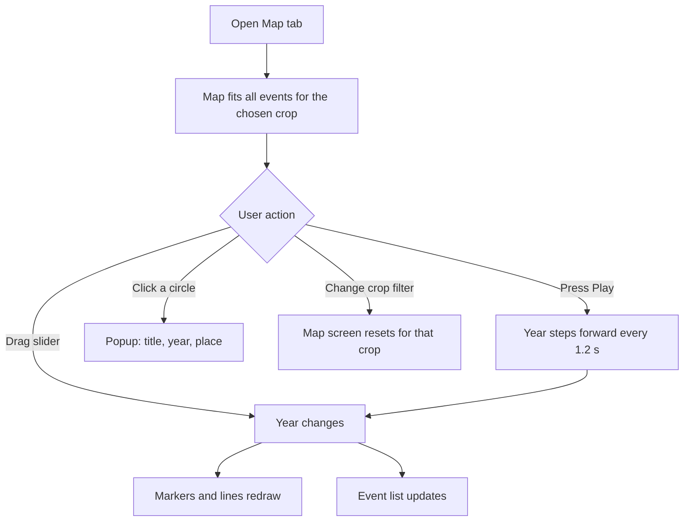
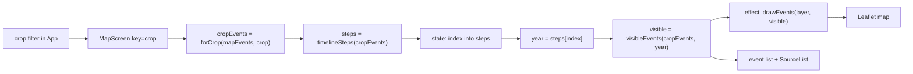
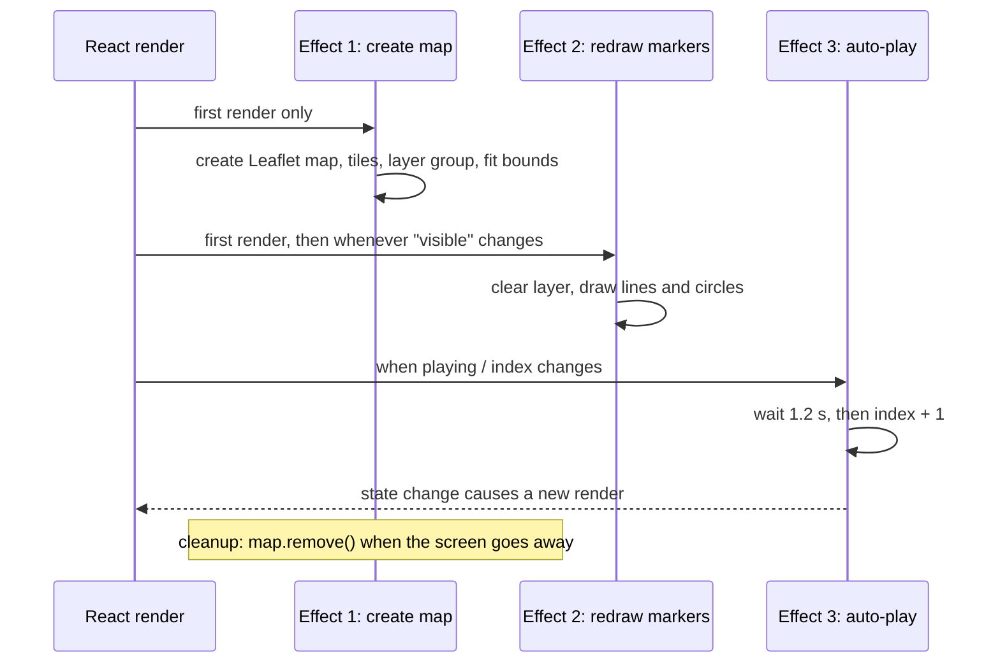

# Phase 2: Origin and Spread Map

**Goal:** the Map screen. It shows where each crop came from and how it spread, with a year slider, a play button, and a text list that mirrors the map.

**Status:** done. `npm test` passes (14 tests) and `npm run build` succeeds. I have not opened the app in a browser, so the visual behaviour is not yet checked by eye (see section 7).

---

## 1. What was built

| Part | What it does |
|---|---|
| `MapScreen` | Draws a Leaflet map, a year slider, a play/pause button, a legend, and an event list |
| `mapYears.ts` | Pure helper functions: year labels, slider stops, "what has happened by year X" |
| Marker styling | Colour = crop, size = origin or spread, fade/dashed = less certain |
| Direction lines | Dashed lines from the place a crop came from to where it went |
| Event list | The same information as the map, as text, with sources |
| CSP fix | Allows OpenStreetMap tile images (`https://tile.openstreetmap.org`) |

## 2. Files added or changed

```
src/
├─ screens/
│  └─ MapScreen.tsx        NEW: the whole Map screen
├─ lib/
│  ├─ mapYears.ts          NEW: year helpers
│  └─ mapYears.test.ts     NEW: tests for them
├─ App.tsx                 CHANGED: shows MapScreen on the Map tab
└─ ../vite.config.ts       CHANGED: CSP now allows tile.openstreetmap.org
```

## 3. Flow diagrams

### 3.1 What the user sees and does



### 3.2 How the screen works inside



### 3.3 The three effects in `MapScreen`



## 4. Key code

### 4.1 Year helpers: `src/lib/mapYears.ts`

```ts
export function formatYear(year: number): string {
  return year < 0 ? `${-year} BCE` : `${year} CE`
}

export function timelineSteps(events: MapEvent[]): number[] {
  return [...new Set(events.map((e) => e.year))].sort((a, b) => a - b)
}

export function visibleEvents(events: MapEvent[], year: number): MapEvent[] {
  return events.filter((e) => e.year <= year).sort((a, b) => a.year - b.year)
}
```

These are plain functions with no React or Leaflet inside, which makes them easy to test (`mapYears.test.ts`).

**Why the slider steps through event years, not every year:** the data spans 7000 BCE to 1882 CE. A normal slider over 9,000 years would leave most positions showing no change, and all the later events would be squeezed into the last few pixels. Stepping through the event years means every move shows something new.

### 4.2 Drawing the markers: `drawEvents`

```ts
function drawEvents(layer: L.LayerGroup, events: MapEvent[]) {
  layer.clearLayers()
  const byId = new Map(events.map((e) => [e.id, e]))

  for (const e of events) {
    const parent = e.from ? byId.get(e.from) : undefined
    if (parent) L.polyline([[parent.lat, parent.lng], [e.lat, e.lng]], { dashArray: '6 6', ... }).addTo(layer)
  }
  for (const e of events) {
    L.circleMarker([e.lat, e.lng], {
      radius: e.kind === 'origin' ? 11 : 7,
      fillOpacity: CONFIDENCE_OPACITY[e.confidence],
      dashArray: e.confidence === 'low' ? '3 3' : undefined,
      ...
    }).bindPopup(popupFor(e)).addTo(layer)
  }
}
```

Each redraw clears the layer and draws what is visible. With about 20 events this is instant, and it is much simpler than tracking which markers to add or remove.

### 4.3 Safe popups: `popupFor`

```ts
function popupFor(e: MapEvent): HTMLElement {
  const box = document.createElement('div')
  const title = document.createElement('strong')
  title.textContent = e.title
  ...
}
```

Leaflet turns a string passed to `bindPopup` into HTML. Building the popup from elements and `textContent` means a stray `<` in the data can never become markup.

### 4.4 Creating the map once, and cleaning up

```ts
useEffect(() => {
  const map = L.map(containerRef.current!, { scrollWheelZoom: false, worldCopyJump: true })
  L.tileLayer('https://tile.openstreetmap.org/{z}/{x}/{y}.png', { maxZoom: 8, attribution: '...' }).addTo(map)
  layerRef.current = L.layerGroup().addTo(map)
  map.fitBounds(bounds, { padding: [30, 30], maxZoom: 5 })
  return () => { map.remove(); layerRef.current = null }
}, [cropEvents])
```

Leaflet is not a React library, so React only holds a reference to the map's container (`useRef`) and creates and destroys the map in an effect. The cleanup function matters: without `map.remove()`, switching tabs would leave old maps behind.

### 4.5 Reset by key: `src/App.tsx`

```tsx
{tab === 'map' && <MapScreen key={crop} crop={crop} />}
```

When `key` changes, React throws the old `MapScreen` away and builds a new one. That resets the slider and play state and refits the map when the crop changes, without any "reset" code.

### 4.6 Auto-play

```ts
useEffect(() => {
  if (!playing) return
  if (index >= steps.length - 1) { setPlaying(false); return }
  const timer = setTimeout(() => setIndex((i) => i + 1), STEP_DELAY_MS)
  return () => clearTimeout(timer)
}, [playing, index, steps.length])
```

Each step schedules the next one. Pausing, dragging the slider, or leaving the screen cancels the pending timer.

## 5. How uncertainty is shown

The brief calls for honest handling of debated history, so each event has a `confidence` of high, moderate, or low.

| Confidence | Look on the map |
|---|---|
| high | solid, strong fill |
| moderate | medium fill |
| low | faint fill and a dashed outline |

The event list repeats this in words ("Confidence: low"), so it does not rely on colour alone.

## 6. Accessibility notes

- The event list below the map has the same information, for users who cannot use the map.
- The slider has an `aria-label` and a text value (`aria-valuetext`, for example "1848 CE"), and the year label announces changes (`aria-live`).
- Mouse-wheel zoom is off so the page can scroll. The +/− buttons and pinch zoom still work.

## 7. Known limits

- **Not yet checked in a browser.** The code compiles, passes its tests, and builds, but I have not looked at the rendered map. Run `npm run dev` and check the map, the slider, play, and the popups. Then run `npm run build` and `npm run preview` to check it under the strict CSP.
- **Straight lines are not real routes.** They show direction only (the screen says so).
- **Map tiles come from OpenStreetMap's public server,** which is fine for a thesis demo and study use. A busy public site should use a tile provider that allows heavy traffic.
- **Dates for low-confidence events are approximate.** All of this content is draft until a domain expert reviews it.
