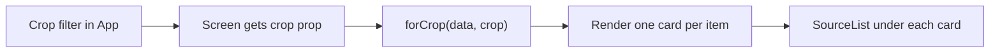
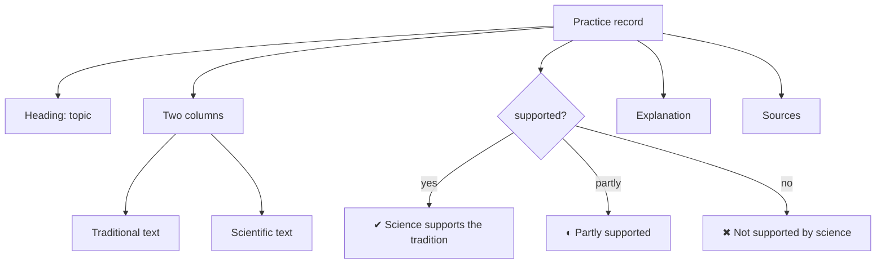
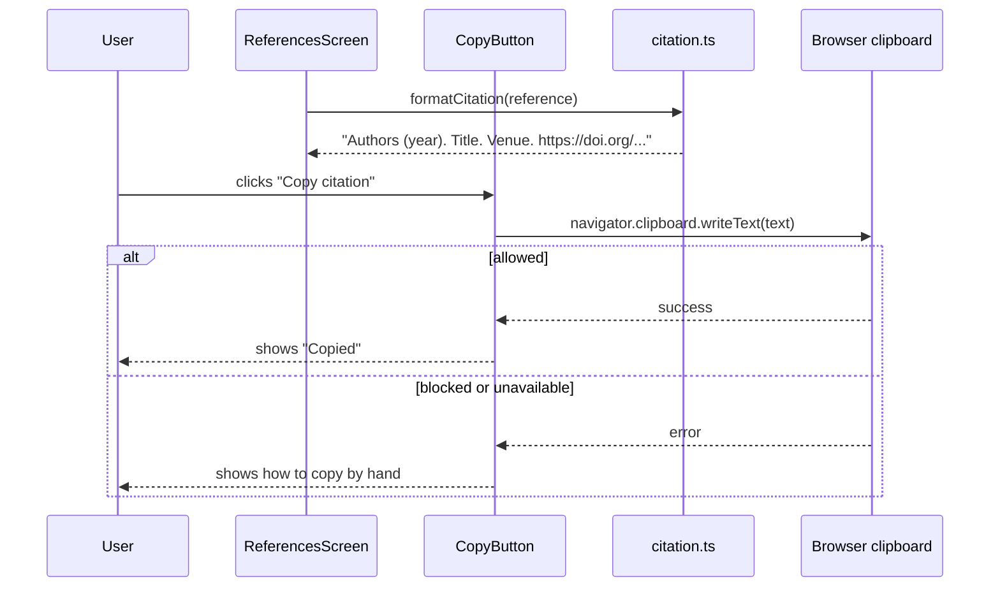

# Phase 3: Compare, Avoid, and References

**Goal:** the last three screens, so every tab in the app works.

**Status:** done. `npm test` passes (15 tests), `npm run build` succeeds, and `npm audit` reports 0 vulnerabilities. I have not opened the app in a browser (see section 7).

---

## 1. What was built

| Screen | What the user gets |
|---|---|
| **Compare** | Each practice as a card: traditional on the left, scientific on the right, a badge saying whether science supports the tradition, an explanation, and sources |
| **Avoid** | "Don't do this" cards, high risk first, each with the reason, a "do this instead" box, and sources |
| **References** | The sources behind the selected crop, with a safe link and a "Copy citation" button per entry, plus "Copy all citations" |

## 2. Files added or changed

```
src/
├─ screens/
│  ├─ CompareScreen.tsx      NEW
│  ├─ AvoidScreen.tsx        NEW
│  └─ ReferencesScreen.tsx   NEW
├─ data/index.ts             CHANGED: added referencesForCrop()
├─ data/data.test.ts         CHANGED: test for referencesForCrop
├─ types.ts                  CHANGED: added cropLabel()
└─ App.tsx                   CHANGED: all four tabs now show real screens
```

## 3. Flow diagrams

### 3.1 All three screens follow the same pattern



### 3.2 Compare screen card



### 3.3 Copying a citation



## 4. Key code

### 4.1 Compare: support badges that do not rely on colour

```tsx
const SUPPORT: Record<Support, { label: string; className: string }> = {
  yes:    { label: '✔ Science supports the tradition', className: 'badge support-yes' },
  partly: { label: '◐ Partly supported',               className: 'badge support-partly' },
  no:     { label: '✖ Not supported by science',       className: 'badge support-no' },
}
```

`Record<Support, ...>` makes TypeScript check that every possible value of `Support` has an entry. If a fourth value is added to the type, the compiler flags this table until it is updated.

### 4.2 Compare layout

```tsx
<div className="compare-grid">
  <div className="col col-traditional"><h4>Traditional</h4><p>{p.traditional}</p></div>
  <div className="col col-scientific"><h4>Scientific</h4><p>{p.scientific}</p></div>
</div>
```

In CSS, `.compare-grid` is one column on phones and two columns from 640 px wide, so the pair stacks on small screens.

### 4.3 Avoid: sorting by severity

```tsx
const SEVERITY_ORDER = { high: 0, medium: 1 } as const

const items = [...forCrop(avoidItems, crop)]
  .sort((a, b) => SEVERITY_ORDER[a.severity] - SEVERITY_ORDER[b.severity])
```

The array is copied first (`[...]`) because `sort` changes the array it is called on, and the shared data should not be changed.

### 4.4 References: only what the crop cites

```ts
export function referencesForCrop(crop: CropFilterValue): Reference[] {
  const cited = new Set(
    [...forCrop(mapEvents, crop), ...forCrop(practices, crop), ...forCrop(avoidItems, crop)]
      .flatMap((item) => item.sourceIds),
  )
  return references
    .filter((r) => cited.has(r.id))
    .sort((a, b) => a.authors.localeCompare(b.authors) || a.year - b.year)
}
```

The reference list is derived from what the content cites, so a reference cannot appear unless something uses it, and nothing can cite a reference that is missing from the list (the Phase 1 tests enforce both directions).

### 4.5 Copy button: handles failure

```tsx
async function copy() {
  try {
    await navigator.clipboard.writeText(text)
    setStatus('Copied')
  } catch {
    setStatus('Copy is not available here. Select the text and copy it by hand.')
  }
}
```

Clipboard access can be refused, for example on a non-secure page or when the browser blocks it. The user always gets a message instead of a silent failure.

## 5. Safety and accessibility notes

- Sources open with `rel="noopener noreferrer"`, so the new tab cannot reach back into the app.
- Links go through `linkFor`, which accepts only valid DOIs and `https` URLs.
- Text from the data files is rendered as React text, which React escapes. No `dangerouslySetInnerHTML` is used anywhere.
- Badges combine a symbol, a word, and a colour.
- Entries marked `*` are not yet checked against the original publication.

## 6. Tests that cover this phase

| Test | File |
|---|---|
| Only cited references are listed per crop, and "all" lists them all | `src/data/data.test.ts` |
| Links and citation text are safe and well-formed | `src/lib/citation.test.ts` |
| Every source cited by compare and avoid items exists | `src/data/data.test.ts` |

There are no automated tests for the screens themselves. They are thin: they filter, map, and render.

## 7. Known limits and next steps

- **Not yet checked in a browser.** Run `npm run dev` and click through all four tabs and all four crop filters. Then run `npm run build` followed by `npm run preview` to check the production build under the strict CSP.
- **All content is a draft.** The facts were written from general knowledge of the literature. Every reference is marked unverified. A domain expert should review the content, and you should check each citation before it goes into a thesis.
- **Content size is small:** 20 map events, 8 practice pairs, 8 avoid items, and 20 references across the three crops. Growing it means adding records to the JSON files. No code changes are needed.
- **Later ideas (from the plan):** a search box, regional languages, and climate-suitability layers.
